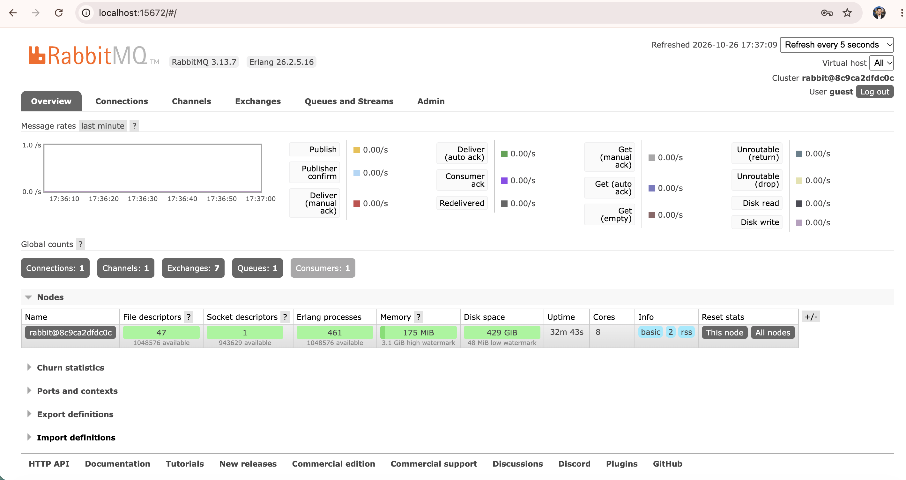
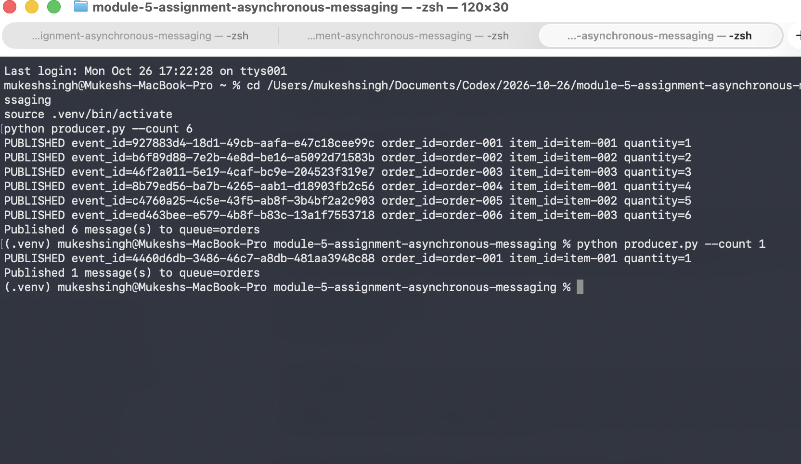
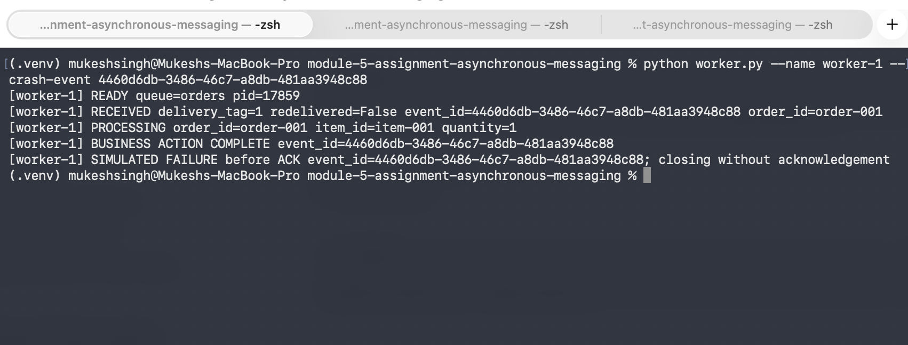
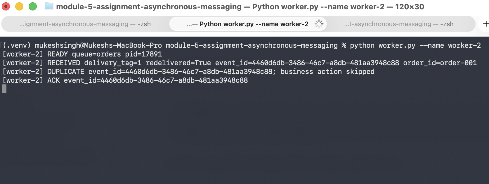
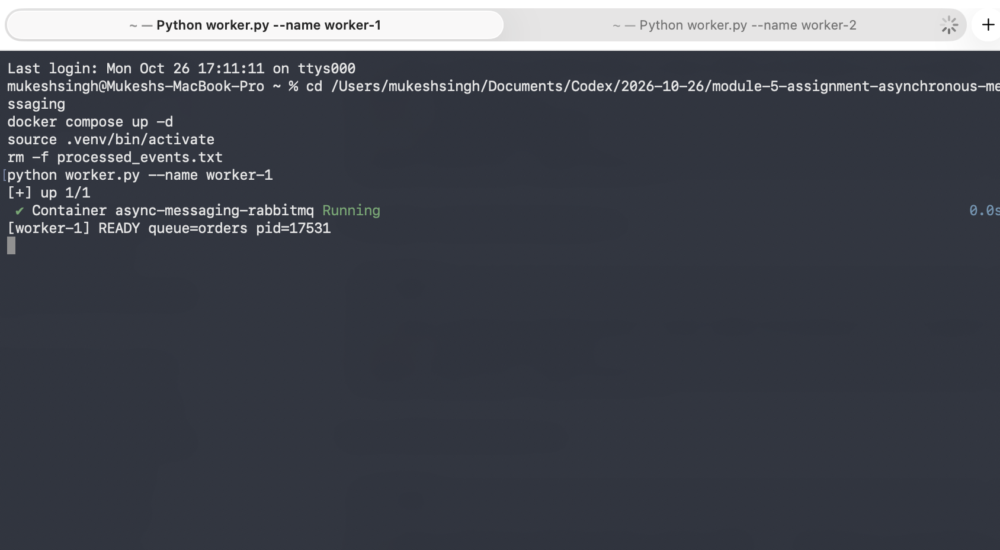
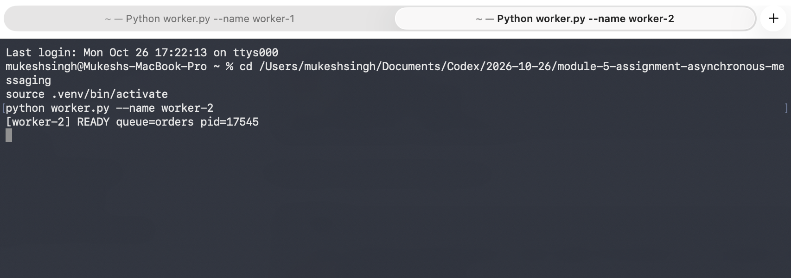
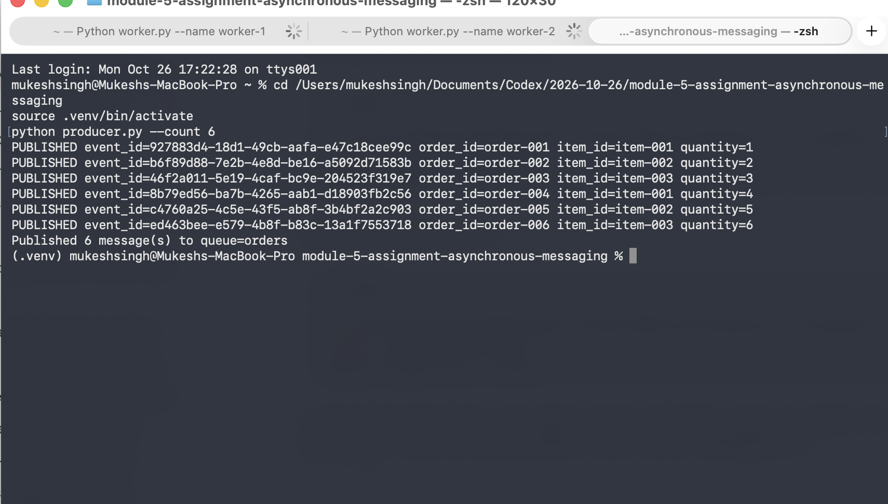

# Asynchronous Messaging with RabbitMQ

This project demonstrates a durable RabbitMQ `orders` queue with one independent producer and two independent competing worker processes. The implementation is Python 3 and uses manual acknowledgements (`auto_ack=False`).

## Architecture

```text
                         publishes
  order producer  ----------------------------->  orders queue
       (producer.py)                              (RabbitMQ)
                                                       |
                                      round-robin, one message each
                                             +---------+---------+
                                             |                   |
                                      worker-1.py          worker-2.py
                                      manual ACK           manual ACK
                                             \                   /
                                              shared idempotency
                                             processed_events.txt
```

## Run it

Requirements: Python 3.10+, Docker, and Docker Compose.

1. Start RabbitMQ:

   ```bash
   docker compose up -d
   python3 -m venv .venv
   . .venv/bin/activate
   pip install -r requirements.txt
   ```

2. Start two workers in two separate terminals. The shared file is intentionally outside the code and is ignored by Git.

   ```bash
   rm -f processed_events.txt
   python worker.py --name worker-1
   python worker.py --name worker-2
   ```

3. In a third terminal, publish six orders:

   ```bash
   python producer.py --count 6
   ```

4. Stop the demo with `Ctrl-C` in each worker terminal and `docker compose down`.

## Successful processing and competing consumers

Each message is delivered to one worker and acknowledged only after processing. With both workers running, output looks like this (event IDs shortened here for readability):

```text
[worker-1] READY queue=orders pid=4101
[worker-2] READY queue=orders pid=4102
[worker-1] RECEIVED ... redelivered=False event_id=4f2... order_id=order-001
[worker-1] PROCESSING order_id=order-001 item_id=item-001 quantity=1
[worker-2] RECEIVED ... redelivered=False event_id=0c9... order_id=order-002
[worker-2] PROCESSING order_id=order-002 item_id=item-002 quantity=2
[worker-1] BUSINESS ACTION COMPLETE event_id=4f2...
[worker-1] ACK event_id=4f2...
[worker-2] BUSINESS ACTION COMPLETE event_id=0c9...
[worker-2] ACK event_id=0c9...
```

The different `order_id` values handled by worker-1 and worker-2 are evidence of competing consumers: RabbitMQ distributes each queued message to only one consumer.

## Failure and redelivery demonstration

To demonstrate a worker dying before its ACK, first publish exactly one order and copy its `event_id` from the producer output. Leave worker-2 running, then start worker-1 with that event ID:

```bash
python producer.py --count 1
python worker.py --name worker-1 --crash-event <EVENT_ID_FROM_PRODUCER>
```

The first worker completes the business action, then exits before `basic_ack`. RabbitMQ detects the closed connection and requeues the unacknowledged message. Worker-2 receives it with `redelivered=True`, detects the event in the shared ledger, skips the business action, and acknowledges it:

```text
[worker-1] RECEIVED ... redelivered=False event_id=abc... order_id=order-001
[worker-1] PROCESSING order_id=order-001 item_id=item-001 quantity=1
[worker-1] BUSINESS ACTION COMPLETE event_id=abc...
[worker-1] SIMULATED FAILURE before ACK event_id=abc...; closing without acknowledgement

[worker-2] RECEIVED ... redelivered=True event_id=abc... order_id=order-001
[worker-2] DUPLICATE event_id=abc...; business action skipped
[worker-2] ACK event_id=abc...
```

This keeps the system running because only the failed worker exits; the second worker remains connected and processes the requeued delivery.

## Screenshot evidence

RabbitMQ management dashboard:



Producer output showing six published orders and the single failure-test message:



Worker terminals showing the failure before ACK and the redelivered duplicate:





The additional worker screenshots show both consumers connected and the producer/worker terminal setup:







## Duplicate handling

Workers atomically check and append `event_id` values in `processed_events.txt` using an exclusive file lock. If the same event is delivered again, either because RabbitMQ redelivered it or because the producer sent the same event twice, the worker logs `DUPLICATE`, skips the business action, and still ACKs the message. The ledger is deliberately simple and local for this assignment; a production service would use a durable shared database or idempotency store.

## Reflection

A message can be delivered more than once when a consumer processes it but crashes, loses its connection, or times out before RabbitMQ receives the ACK. RabbitMQ then cannot know whether the business action completed, so it safely redelivers the unacknowledged message. Idempotent handling records each `event_id` and checks that record before performing the business action. This allows the retry to be acknowledged without charging, shipping, or otherwise applying the same order twice.
